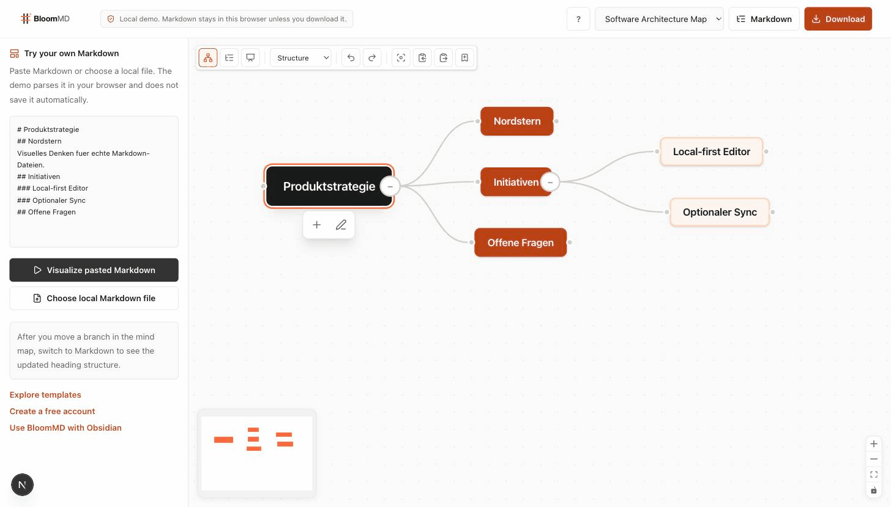

<p align="center">
  <picture>
    <source media="(prefers-color-scheme: dark)" srcset="assets/logo-stacked-dark.png" />
    <source media="(prefers-color-scheme: light)" srcset="assets/logo-stacked-light.png" />
    
  </picture>
</p>

<p align="center">
  <strong>The Markdown workspace for LLM-maintained knowledge.</strong>
</p>

<p align="center">
  BloomMD turns raw Markdown sources into navigable, verifiable knowledge maps while keeping Markdown as the source of truth.
</p>

<p align="center">
  <a href="https://bloommd.io">Website</a> ·
  <a href="https://bloommd.io/demo">Open Demo</a> ·
  <a href="https://bloommd.io/templates">Browse Templates</a> ·
  <a href="plugins/obsidian">Obsidian Preview</a> ·
  <a href="https://github.com/moellenbeck-digital/BloomMD/issues/new/choose">Report a Bug</a>
</p>

<p align="center">
  
</p>


## What is BloomMD?

BloomMD is a local-first workspace for building an LLM-maintained wiki from ordinary Markdown. Headings become nodes, nested headings become branches, and the text under each heading stays as the node content.

You can explore raw sources visually, connect concepts across maps, drag branches to restructure them, edit the distilled knowledge, and save the result back to normal `.md` files. The map is the interface; Markdown files remain portable and inspectable in Git, Obsidian, VS Code, or any text editor.

BloomMD is becoming the visual layer for the **LLM Wiki pattern**: raw sources stay immutable, an interconnected Markdown wiki becomes the queryable knowledge layer, and human-defined conventions form the schema. Agents may later maintain the wiki, but every change remains reviewable Markdown rather than hidden model memory.

BloomMD runs as a **closed beta**: while the closed-beta gate is on (`BLOOMMD_BETA_ACCESS=1`) the hosted
cloud application is invitation only; with the gate off, anyone can register themselves (email
confirmation, consent to privacy policy and terms, and signup rate limits still apply). The demo
and the template library stay open to everyone. Desktop workspaces and local OKF/LLM-Wiki bundles
work without any account. Obsidian compatibility is demonstrated during M1 with real local notes;
the full Obsidian plugin beta distribution follows in M2.

**In scope:** Web, macOS Desktop, OKF/LLM-Wiki, and collaboration marked as beta on a single instance.
Linux and Windows desktop builds are planned as follow-up beta releases after M1.
**Out of scope:** mobile Obsidian, a public SaaS launch, billing, the template marketplace, the VS Code
extension, and hosted autonomous agents.

Full wording is in [docs/BETA-SCOPE.md](docs/BETA-SCOPE.md). Active launch work is tracked in the
[public BloomMD roadmap](https://bloommd.io/roadmap).

## Why BloomMD?

- **Markdown stays portable.** Your files still work in Git, VS Code, Obsidian, iCloud, Dropbox, and any text editor.
- **Visual thinking without lock-in.** The map is an interface, not a proprietary document format.
- **Fast onboarding.** Start from real templates instead of a blank canvas.
- **Local-first by default.** Files can be processed locally, and cloud sync is optional.
- **Useful for real work.** Architecture maps, research projects, startup planning, writing, content strategy, and Obsidian vaults.
- **Ready for agent-maintained knowledge.** A future-proof Markdown/OKF-compatible bundle can be browsed by people, agents, search indexes, and graph tools.

## Product Demo

Try BloomMD without an account:

- Try online: https://bloommd.io
- Open demo: https://bloommd.io/demo
- Browse templates: https://bloommd.io/templates

The demo can load a template, visualize pasted Markdown, or read a local Markdown file in the browser. Analytics events must not include Markdown contents, file names, folder names, or personal note text.

## How Markdown Becomes a Mind Map

```markdown
---
title: Product Strategy
tags: [strategy, roadmap]
---

# Product Strategy <!-- bloommd:id=product-strategy -->
## North Star <!-- bloommd:id=north-star -->
Visual thinking for real Markdown files.

## Initiatives <!-- bloommd:id=initiatives -->
### Local-first editor <!-- bloommd:id=local-first-editor -->
### Optional sync <!-- bloommd:id=optional-sync -->
```

BloomMD reads the heading hierarchy and builds the map from it. Stable `bloommd:id` comments make durable links possible while the file remains readable in other Markdown tools.

## LLM Wiki Layer

BloomMD follows the three-layer model described by Andrej Karpathy's [LLM Wiki pattern](https://gist.github.com/karpathy/442a6bf555914893e9891c11519de94f):

| Layer | BloomMD role |
|---|---|
| Raw sources | Original Markdown notes, web references, files, PDFs, images, videos, and imported documents remain preserved. |
| Wiki | Interconnected Markdown concept pages become the distilled, browsable knowledge layer. BloomMD visualizes pages, links, backlinks, provenance, and stale-source state. |
| Schema | Human-defined templates, metadata conventions, review rules, and workflows control what an agent may change. |

The planned workflow is deliberately explicit:

```text
source -> ingest -> proposed wiki changes -> human review -> query -> lint
```

BloomMD's current release provides the Markdown editor, map navigation, links, backlinks, typed resources, local workspaces, and source-of-truth guarantees required by this model. The Core package now also provides an OKF v0.2 Wiki Bundle that still reads v0.1 bundles, deterministic index/log/status/lint operations, source-hash provenance, safe resource extraction, and an approval-gated Markdown proposal workflow. BloomMD will not silently rewrite a user's knowledge base.

BloomMD reads and writes the [Open Knowledge Format](https://github.com/GoogleCloudPlatform/knowledge-catalog/tree/main/okf) at **v0.2** and still reads v0.1 bundles. New bundles declare `okf_version: 0.2` in the root `index.md`.

OKF v0.2 trust signals are parsed, linted, and surfaced in the Wiki browser and the agent tools:

| Signal | Question it answers |
|---|---|
| `sources[].resource`, `author`, `last_modified` | Where did this come from? |
| `generated: { by, at }` | Which agent or process wrote it? |
| `verified: [{ by, at }]` | Who signed off on it? |
| `status: draft \| stable \| deprecated` | How settled is it? |
| `stale_after: YYYY-MM-DD` | Is it still current? |

From `generated` and `verified` BloomMD derives a trust tier — `verified`, `generated`, or `unattributed` — so a consumer can decide how far to rely on a page. BloomMD's own `contentHash` per source is an optional extension that additionally enables drift detection against the raw source; a plain OKF bundle without it stays conformant. Per OKF §11 BloomMD degrades gracefully: unknown `status` values, missing optional fields, and absent index files are reported by `lint` but never reject a bundle.

### Local Wiki Workflow

The deterministic local workflow does not require an LLM or network access:

```bash
bloommd-wiki init ./wiki "My Knowledge Wiki"
bloommd-wiki index ./wiki
bloommd-wiki status ./wiki ./source-hashes.json
bloommd-wiki lint ./wiki ./source-hashes.json
bloommd-wiki propose ./wiki ./changes.json ./proposal.json
bloommd-wiki approve ./proposal.json "reviewer"
bloommd-wiki apply ./wiki ./proposal.json
```

`apply` requires an explicit reviewer and rechecks the source hash before writing. Every approved apply regenerates `index.md` and appends an audit entry to `log.md`.

## Key Features

- Interactive Markdown mind map
- Drag-and-drop branch restructuring
- Rich node content editor
- Markdown preview and export
- On-demand website previews for web and source nodes, including title, description, domain, and social image metadata
- Command Palette with file and node search
- Recent maps, favorites, and tabs
- Portal nodes and fast switching between maps
- Topic, web, file, PDF, source, task, and decision nodes
- Separate hierarchy, link, and backlink edge views
- Focus, outline, and presentation modes
- Local saved views with viewport, focus, collapse, and edge state
- Visual before/inside/after drop positions, multi-select, and branch copy/paste
- Local browser folder workspaces through the File System Access API
- Internal map links and backlinks
- Broken-link indicators
- Markdown links, local attachments, PDFs, images, and video references remain portable resources
- Template library with public landing pages
- No-login public demo

## Templates

The first six templates live in [`templates/`](templates):

- [Software Architecture Map](templates/software-architecture/template.md)
- [Startup Operating System](templates/startup-operating-system/template.md)
- [Obsidian Vault Starter](templates/obsidian-vault-starter/template.md)
- [Research Project Map](templates/research-project/template.md)
- [Novel Writing Map](templates/novel-writing/template.md)
- [Content Strategy Map](templates/content-strategy/template.md)

Each template has `template.md`, `metadata.json`, and a public preview image path. Public pages are prepared at `/templates/<slug>`, and each template can be opened in `/demo?template=<slug>` or downloaded as Markdown.

## Obsidian Integration

[`plugins/obsidian`](plugins/obsidian) contains the BloomMD for Obsidian companion plugin. The
monorepo is its only development source; `moellenbeck-digital/bloommd-obsidian` is a generated,
read-only release mirror for BRAT and manual distribution. The M1 plugin beta is desktop-only.

The Markdown parser and lossless structural operations are shared through `@bloommd/core/browser`.
Obsidian-specific Vault, View, settings, and UI behavior stays in the plugin. Use
[`plugins/obsidian/RELEASE.md`](plugins/obsidian/RELEASE.md) for the mirror and release contract.

- `BloomMD: Visualize current note`
- `BloomMD: Open current note in BloomMD`
- `BloomMD: Visualize current folder`
- Ribbon button for the current note
- Interactive React Flow mind map with free node positioning, pan, cursor zoom, minimap, search, and Fit View
- Inline title editing and an autosaving Markdown content inspector
- Child/sibling creation, branch reparenting, collapse, delete, and conflict-safe undo/redo
- External links, Obsidian wiki links, linked mentions, and fast note switching
- Local layout persistence while Markdown remains the source of truth
- No plugin telemetry

By default, the plugin keeps vault contents local and does not put Markdown content into URL parameters. A note is transferred only after the explicit `Share current note with BloomMD workspace` command; its local vault path is never sent. Stable node IDs use valid Markdown HTML comments; visual positions and viewport state remain in Obsidian's local plugin data.

## Web, Desktop, Wiki and Sync

| Area | Technology | Beta status |
|---|---|
| Web | Next.js 16 App Router with Turbopack | Hosted beta: invitation only with the gate on, open self-registration with the gate off |
| Desktop | Electrobun v1 | Recommended local beta path on macOS for M1, no account required |
| OKF / LLM-Wiki | BloomMD CLI, MCP transport, `@bloommd/core` | Local and offline-capable |
| Sync | Bun WebSocket service, Yjs, Postgres persistence | Beta, one writer replica only |
| Mobile | Capacitor 8 | Package exists, but mobile support is outside the M1 beta scope |

The mobile package remains in the monorepo for technical continuity, but mobile testing and support
are explicitly out of scope for the closed beta. The beta promise is Web, Desktop, local
OKF/LLM-Wiki, and collaboration marked as beta.

The supported build runtime is Node.js 22. Node.js 23 and other odd-numbered releases are intentionally outside the release matrix.

## Web App Split

BloomMD ships two independently buildable Next.js applications from one monorepo:

| App | Domain | Purpose |
|---|---|---|
| `apps/marketing` / `@bloommd/marketing` | `bloommd.io` | Landing page, docs/Fumadocs, legal pages, templates, isolated demo, optional public Wiki (the waitlist has ended; registration is at `bloommd.app/signup`) |
| `apps/app` / `@bloommd/web-app` | `bloommd.app` | Private app, auth, account, workspaces, OKF/llm-wiki, sync and collaboration |

`BLOOMMD_DEPLOYMENT` is obsolete after the split and `release:check` rejects it. Marketing builds
must not receive `DATABASE_URL`, `BLOOMMD_AUTH_SECRET`, `BLOOMMD_SYNC_SECRET`,
`NEXT_PUBLIC_SYNC_URL`, or Stripe secrets. The remaining waitlist data lives in
`BLOOMMD_WAITLIST_DATABASE_URL` until it is exported, invited once and purged, so the marketing
app has no access to user accounts or workspaces. The product app is globally `noindex, nofollow`; marketing only indexes
intended public pages.

The application boundaries are described in [docs/ARCHITECTURE.md](docs/ARCHITECTURE.md).

For local split development the product app runs on `http://127.0.0.1:3210` via
`bun run dev:app`; the marketing app runs on `http://127.0.0.1:3212` via
`bun run dev:marketing`. Old waitlist links (`/waitlist`, confirmation) redirect to the registration of the product app; only the unsubscribe page and API of the marketing app remain.

## Local-first Architecture

Markdown is the storage format. BloomMD can run as a local workflow where the user opens a file or folder, edits visually, and saves back to disk. Opening a folder creates a derived workspace map: the folder is the root, Markdown files become file nodes, each file expands into its heading tree, and cross-file `[[Page]]` references become relation edges. The derived workspace view is not saved as one Markdown file; editing and persistence stay scoped to the concrete source file opened from a file node. Accounts are only needed for persistent cloud workspaces, sync, billing, or other cloud features.

The optional Wiki binary keeps local Markdown checks and Wiki maintenance explicit:

```bash
bloommd-wiki workspace open .                 # open a local folder in the Desktop app
bloommd-wiki workspace open ./note.md         # open a Markdown file in the Desktop app
bloommd-wiki workspace lint .                 # analyse Markdown links and duplicate names
bloommd-wiki workspace check .                # verify round-trip safety
bloommd-wiki workspace search "term" .        # search a local workspace
bloommd-wiki status ./wiki                    # inspect a local OKF/LLM-Wiki bundle
```

`bloommd-wiki workspace open ...` is the intended Desktop handoff command for M1. It resolves the
target path and hands it to the native app through the registered `bloommd://open` URL scheme.

Authenticated cloud workspaces use Postgres tables scoped by `workspace_id`. Connectivity is provider neutral, so a CloudNativePG cluster and a hosted Postgres behave the same. Every document operation verifies workspace membership, viewer/editor/owner permissions, and optimistic document versions. Realtime clients receive short-lived, HMAC-signed tickets bound to one user, workspace, document, filename, permission, and expiry. The sync service rechecks membership and write role before persistence.

Cloud APIs support signed browser sessions and revocable personal access tokens for native clients. A composite database constraint prevents saved views from referencing a document in another workspace. Public sync is limited to one writer replica until distributed coordination and multi-replica conflict handling have been validated operationally.

Browser folder workspaces never enter this cloud path: the selected directory handle stays in the browser, files are read and written with explicit browser permission, and local documents do not auto-connect to sync.

## Installation

```bash
# Node.js 22 and Bun 1.3.x
bun install

# Web
bun run dev:app
bun run dev:marketing

# Desktop
bun run --cwd packages/desktop build:renderer
bun run --cwd packages/desktop dev

# M1 release artifacts
bun run build:release-artifacts     # builds agent/wiki single binaries and artifacts/bloommd-sync
bun run build:desktop-macos         # builds the stable macOS BloomMD.app and DMG
bun run verify:desktop-macos        # verifies the stable macOS DMG and app bundle signature

# Optional mobile package, not part of the closed beta support scope
bun run --cwd packages/mobile build
```

Local OKF/LLM-Wiki work does not need a server:

```bash
bloommd-wiki workspace lint .
bloommd-wiki workspace check .
bloommd-wiki init ./wiki "My Knowledge Wiki"
bloommd-wiki lint ./wiki
bloommd-wiki mcp ./wiki
```

## M1 Release Artifacts

M1 uses deliberately separate artifacts:

| Artifact | Build command | Purpose |
|---|---|---|
| Desktop app | `bun run build:desktop-macos` | Recommended local beta path for opening Markdown files and folders directly |
| Linux Pacman package | `bun run build:desktop-linux` + `bun run package:desktop-arch` | Native Omarchy 4 / Arch package for x86_64 and ARM64; public assets use `bloommd-desktop-<version>-x86_64.pacman` and `bloommd-desktop-<version>-aarch64.pacman` |
| `artifacts/bloommd-agent-<platform>` | `bun run build:agent-runtime-release` | Optional diagnostics/automation runtime; the normal OpenClaw installation bundles it in the plugin |
| `artifacts/bloommd-wiki-<platform>` | `bun run build:wiki-cli-release` | Optional local Markdown checks, OKF/LLM-Wiki lifecycle and MCP transport |
| `artifacts/bloommd-sync` | `bun run build:sync-binary` | Optional self-hosted sync server binary next to the container |
| Web app / Marketing app | Docker/Next.js build | Hosted `bloommd.app` and `bloommd.io` deployments |

The Next.js apps are **not** shipped as Bun single binaries for M1. The container path is the
supported deployment target; `next-bun-compile` stays out of the beta release path until there is a
concrete target environment that cannot run containers.

The M1 macOS Desktop artifact is ad-hoc signed so the bundle passes `codesign --verify`; it is not
Developer-ID-signed or notarized yet because the Apple Developer Account approval is still pending.
Gatekeeper will therefore still show the expected beta warning.
Use `bun run verify:desktop-macos` after every local or CI build before publishing the DMG.

The Linux beta track is built natively for x86_64 and ARM64/aarch64 and packaged with `makepkg`
for Omarchy 4 and other Arch-based systems. Packaging sources are in [packaging/arch](packaging/arch).

For the optional mobile native project:

```bash
cd packages/mobile
bun run build
bunx cap sync
# Open the generated iOS project in Xcode after `cap add ios` has been run once.
```

## Development Setup

```bash
bun install --frozen-lockfile
bun run typecheck
bun run test
bun run test:qa
bun run build
bun run test:e2e
bun run --cwd apps/app test:e2e:beta
bun run --cwd apps/app test:e2e:wiki
bun run --cwd apps/marketing test:e2e
bun audit
```

The full M1 acceptance matrix, including the native macOS smoke and post-M1 platform plans, lives
in [docs/M1-TESTPLAN.md](docs/M1-TESTPLAN.md). The detailed UI-QA coverage for Desktop, Web,
Collaboration, Wiki and follow-up platform releases lives in [docs/M1-UI-QA-MATRIX.md](docs/M1-UI-QA-MATRIX.md).
The reproducible local macOS runner can be started with `bun run qa:m1:mac`.

### Optional LLM Wiki browser

BloomMD can expose a read-only browser for an OKF-compatible Markdown bundle. Keep it disabled by default; on a trusted Hetzner deployment set `BLOOMMD_WIKI_DIR` to the mounted bundle and `BLOOMMD_WIKI_PUBLIC=1`. The browser is available at `/wiki` and `/api/wiki`. Wiki mutations remain an explicit, audited CLI/agent workflow and are never accepted by the public web route. Signed-in reviewers can approve or discard agent proposals on `/wiki` of the app when `BLOOMMD_WIKI_PROPOSALS_DIR` is set (off by default; see `docs/WEB-COLLABORATION-AND-WIKI.md`).

For a local agent client, use the provider-neutral MCP transport against an explicitly selected bundle:

```bash
bloommd-wiki mcp /path/to/wiki
```

It exposes deterministic status/page reads and the `propose`, `approve`, and `apply` tools. The server has no model credentials and does not upload Wiki content.

Playwright runs with `BLOOMMD_E2E_AUTH_BYPASS=1` from `apps/app/playwright.config.ts`, so local E2E coverage does not depend on external auth or a reachable database. The suite still checks route protection and rejects anonymous mindmap API access.

### Environment

Copy `apps/app/.env.example` to `apps/app/.env.local` for local product development and
`apps/marketing/.env.example` to `apps/marketing/.env.local` for the public site. A local app demo
can run with file storage and auth bypass defaults; the hosted beta needs a stricter environment.

Required for the hosted closed beta:

- `DATABASE_URL` with `sslmode=require` or `sslmode=verify-full`
- `BLOOMMD_AUTH_SECRET`
- `BLOOMMD_REQUIRE_AUTH=1`
- `BLOOMMD_BETA_ACCESS=1` (closed-beta gate on: invitation only; any other value or unset: open
  self-registration, then no invitation list is required)
- `BLOOMMD_INTERNAL_INVITE_SECRET` for DB-backed beta invites (no longer used by the marketing app since the waitlist admin was removed)
- optional fallback: `BLOOMMD_BETA_ALLOWED_EMAILS` or `BLOOMMD_BETA_INVITE_CODES`
- `BLOOMMD_BILLING_ENABLED=0`
- `BLOOMMD_AUTO_MIGRATE=0`
- `NEXT_PUBLIC_SITE_URL`
- `NEXT_PUBLIC_APP_URL=https://bloommd.app`
- `NEXT_PUBLIC_MARKETING_URL=https://bloommd.io`
- `RESEND_API_KEY`
- `RESEND_FROM_EMAIL`
- `SENTRY_DSN`
- `NEXT_PUBLIC_SENTRY_DSN`
- `BLOOMMD_FEEDBACK_ENABLED=1`
- `BLOOMMD_FEEDBACK_GITHUB_TOKEN`
- `BLOOMMD_FEEDBACK_GITHUB_REPO=moellenbeck-digital/BloomMD`
- `BLOOMMD_FEEDBACK_S3_ENDPOINT`
- `BLOOMMD_FEEDBACK_S3_REGION`
- `BLOOMMD_FEEDBACK_S3_BUCKET`
- `BLOOMMD_FEEDBACK_S3_ACCESS_KEY_ID`
- `BLOOMMD_FEEDBACK_S3_SECRET_ACCESS_KEY`
- `BLOOMMD_LEGAL_*`

Build metadata is public and injected by CI/Docker so support and feedback can identify the running
release without exposing secrets:

- `BLOOMMD_RELEASE_VERSION` / `NEXT_PUBLIC_BLOOMMD_VERSION`
- `BLOOMMD_BUILD_SHA` / `NEXT_PUBLIC_BLOOMMD_GIT_SHA`
- `BLOOMMD_BUILD_TAG` / `NEXT_PUBLIC_BLOOMMD_GIT_TAG`
- `BLOOMMD_BUILD_TIME` / `NEXT_PUBLIC_BLOOMMD_BUILD_TIME`

`/api/version` on both hosted apps returns the same non-secret build metadata. Production remains
pinned by immutable `sha-<commit>` image tags or image digests; Git tags and visible versions are for
humans, feedback and release communication.

Optional for analytics and later sync:

- `NEXT_PUBLIC_POSTHOG_KEY`
- `NEXT_PUBLIC_POSTHOG_HOST`
- `NEXT_PUBLIC_SYNC_URL`
- `BLOOMMD_SYNC_SECRET` (at least 32 random characters, shared with the sync service)
- `SYNC_DATABASE_URL` with the same TLS rule as `DATABASE_URL`
- `SYNC_ALLOWED_ORIGINS`
- `SYNC_REPLICA_COUNT=1`
- `BLOOMMD_FEEDBACK_GITHUB_PROJECT_ID`
- `BLOOMMD_FEEDBACK_GITHUB_STATUS_FIELD_ID`
- `BLOOMMD_FEEDBACK_GITHUB_FEEDBACK_OPTION_ID`

Required for the early public marketing deployment:

- `NEXT_PUBLIC_SITE_URL=https://bloommd.io`
- `NEXT_PUBLIC_MARKETING_URL=https://bloommd.io`
- `NEXT_PUBLIC_APP_URL=https://bloommd.app`
- `BLOOMMD_WAITLIST_DATABASE_URL` only while waitlist data still has to be exported, invited and purged
- `RESEND_API_KEY` and `RESEND_FROM_EMAIL` for the one-time invitation mail
- no `DATABASE_URL`, `BLOOMMD_AUTH_SECRET`, `BLOOMMD_SYNC_SECRET`, `NEXT_PUBLIC_SYNC_URL`, or Stripe secrets

Winding down the waitlist (a human runs these against production; every destructive or outgoing
step is a dry-run unless `--apply` is given):

```bash
bun run --cwd apps/marketing waitlist count               # confirmed / pending / unsubscribed / total
bun run --cwd apps/marketing waitlist export --out waitlist.csv   # email, status, time, source; ends with "N Einträge, davon bestätigt M"
bun run --cwd apps/marketing waitlist invite              # dry-run: lists who would get the one-time mail
bun run --cwd apps/marketing waitlist invite --apply      # sends it (confirmed, not unsubscribed, once per address)
bun run --cwd apps/marketing waitlist purge               # dry-run: would deleting be allowed?
bun run --cwd apps/marketing waitlist purge --apply       # deletes ALL entries
```

`invite --apply` marks each address in the table before mailing it, so a second run writes to nobody
again; a failed send releases the mark. `purge --apply` is refused while confirmed addresses have not
been invited and until `WAITLIST_PURGE_RETENTION_DAYS` (90, `src/lib/waitlist-retention.ts`) after the
last invitation mail. The privacy policy names the same 90 days.

The public marketing entrypoints are `/` for German and `/en` for English beta participants. Both
must keep the same product scope, beta CTA, app login target and release version visibility before
the first tester communication goes out.

M1 analytics is optional and off by default. Leave `NEXT_PUBLIC_POSTHOG_KEY` and
`NEXT_PUBLIC_POSTHOG_HOST` unset unless the deployment is explicitly approved to use PostHog. When
enabled, analytics loads only after consent. The product app sends path-only pageviews; the marketing
app sends path-only pageviews and allowlisted, content-free demo events from
`apps/marketing/src/lib/telemetryPrivacy.ts`. Because these are `NEXT_PUBLIC_*` values, hosted
Next.js images need to be built with the values present; changing only a runtime secret does not
activate analytics in an already built browser bundle.

Stripe credentials are intentionally not required for the closed beta. They are only demanded when
`BLOOMMD_BILLING_ENABLED=1`; while the flag is off, checkout, portal and webhook routes answer
`404`.

Run `bun run --cwd apps/app release:check` and `bun run --cwd apps/marketing release:check` with the
respective production environments before deploying Docker targets to Hetzner. They fail closed when
provider credentials, legal identity, TLS URLs, secret entropy, beta access, waitlist separation, or
the supported sync topology are incomplete.


## Demo Assets

Recordings must be real screen captures of the running app. Synthetic or mocked recordings must not
be used — the product claim is that Markdown stays intact, so the demo has to show the real thing.

| Asset | State |
|---|---|
| `assets/demo-open-map.gif` | Recorded against the local build: pasted Markdown becomes a mind map. |
| `assets/demo-branch-drag-markdown.webm` and `apps/marketing/public/demo-branch-drag-markdown.webm` | Recorded against the local browser demo: a real pointer drag reparents `Alpha` under `Beta`, then the Markdown view shows `### Alpha` below `## Beta`. |
| `assets/demo-obsidian-note-map.webm` and `apps/marketing/public/demo-obsidian-note-map.webm` | Recorded against Obsidian Desktop 1.13.7 with a real local note from the `MyBrain` vault: BloomMD opens the note as an interactive map. |

## Roadmap

The [public roadmap](https://bloommd.io/roadmap) summarizes work that is ready to share. Browse and report concrete requests in [GitHub Issues](https://github.com/moellenbeck-digital/BloomMD/issues); maintainers plan them in the internal project board.

## Contributing

See [CONTRIBUTING.md](CONTRIBUTING.md) for the source repository, pull request workflow,
license terms, and safe issue reporting. Report suspected vulnerabilities through
the private channel in [SECURITY.md](SECURITY.md).

Useful starting points:

- [Report a bug](https://github.com/moellenbeck-digital/BloomMD/issues/new?template=bug_report.yml)
- [Request a feature](https://github.com/moellenbeck-digital/BloomMD/issues/new?template=feature_request.yml)
- [Request a template](https://github.com/moellenbeck-digital/BloomMD/issues/new?template=template_request.yml)
- [Request an integration](https://github.com/moellenbeck-digital/BloomMD/issues/new?template=integration_request.yml)
- [Obsidian plugin issue](https://github.com/moellenbeck-digital/BloomMD/issues/new?template=obsidian_plugin_issue.yml)

GitHub Discussions should be enabled with categories for Ideas, Feature Requests, Questions, Show and Tell, Templates, and Integrations.

## License

BloomMD source from the Marketing 0.5.1 release commit onward is licensed under the
[Elastic License 2.0](LICENSE). Earlier published versions, including Desktop
`v0.5.14`, remain under their original MIT terms; the previous license text is
preserved in [LICENSE-MIT-legacy](LICENSE-MIT-legacy). The separately released
[Obsidian plugin](plugins/obsidian/LICENSE) uses ELv2 from its next public release;
published plugin versions through 0.5.12 remain MIT.

Historical binary releases and their license boundary are explained in
[Release history](docs/RELEASE-HISTORY.md).
See [licensing and artifact notes](docs/LICENSING.md) for the release boundaries.
