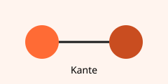

# Kapitel 3

Liegt in einem anderen Unterordner — gut, um die Ordner-Kanten der Workspace-Karte zu sehen.

Verweist auf [[Kapitel 1]] und auf ein Bild: 

Und auf eine Datei, die es **nicht** gibt: 
